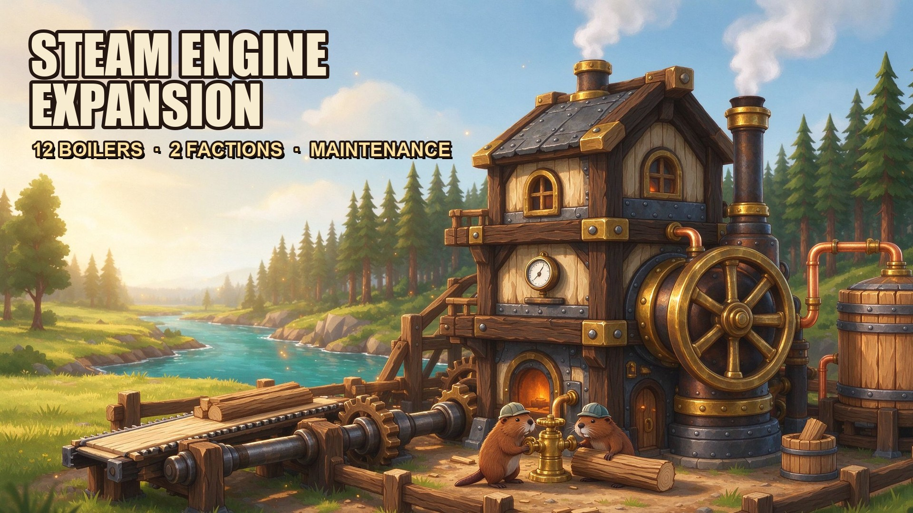

# Steam Engine Expansion（SEE）— 蒸汽引擎擴充

> Timberborn `1.1.2.8` 模組｜版本 **0.1.0**｜狀態：**離線門禁全綠、已安裝、待人類實機驗收（P8）**
> GitHub：<https://github.com/stanley-1028/SteamEngineExpansion>｜Release（latest）：<https://github.com/stanley-1028/SteamEngineExpansion/releases/latest>
> Steam 工作坊：<https://steamcommunity.com/sharedfiles/filedetails/?id=3836039641>（ItemId 3836039641，v0.1.0）
> 12 種「免工人、燒燃料、耗水」的蒸汽引擎：3 尺寸 × 4 等級 × 2 陣營，附週期維護系統與三外部模組軟依賴。
>
> ⚠ **工作坊已上架 v0.1.0**（ItemId 3836039641）；本輪熱修-6 的重新上傳需由擁有者在遊戲內 **Mods → Update**
> 執行（Steam 無公開發佈 API；`mod/workshop/DESCRIPTION.md` 已備好貼上文案）。離線門檻（建置／測試／validator／平衡模擬）全 PASS，
> 但 T2–T6 實機項、UI 原版化外觀（步驟 1b／1c）與動畫（AC-21）仍待驗；請照 `docs/TEST_PROTOCOL.md` 執行並由人類簽核。
>
> 2026-11-08 UI 修正：SEE 面板**預設展開**（標題含目前狀態）、新增 **zhCN** 63 鍵本地化
> （遊戲簡中環境不再出現空白列與 63 條 missing-key 警告）。
>
> 2026-11-08 行為修正（熱修-4，Lead 裁決 AD-16）：**夜間待機運轉**——只要燃料與水充足且未暫停／維護／機況 0，
> 即使入夜後電網需求為 0，引擎仍以 `balance.standbyLoadRatio`（預設 **0.10**）持續運轉，不再熄火停機；
> 設 `0` 可恢復舊的 `Idle` 行為（玩家回報「晚上引擎停機」；根因＝原版在非工作時間停用耗電端使 `PowerDemand` 歸零）。
>
> 2026-11-08 修正（熱修-5，Lead 裁決 AD-18／AD-19／AD-20，玩家回報）：
> **① 不再顯示「需要搬運工才能運轉」**——完工鍋爐以 public `NoHaulingPostStatus.Disable()` 關閉原版搬運工需求狀態
> （沒有搬運工／搬運站時也不顯示；根因＝原版對「無 `Workplace` 的 GCB 建築」自動掛上該狀態；不刪燃料庫存、不改搬運路徑、不用 Harmony）。
> **② 耗水量全 12 檔減半**——每 100 hp 耗水 T1 0.040／T2 0.035／T3 0.020／T4 0.010（舊值 0.080／0.070／0.040／0.018）；
> 水艙容量依新耗水率重算（`waterTankHours` 仍 200，滿艙自主時間不變），燃料與其他數值不變。
> 生成器閘門 1 同步改為「水艙自主時間 ≥8× 燃料庫存自主時間」（AD-20）。
>
> 2026-11-14 更新（熱修-6，Lead 裁決 AD-21／AD-22／AD-23，玩家要求「UI／GUI 原版化＋收縮型菜單」）：
> **① 面板原版化**——SEE 區塊改用原版九宮格卡片／字體／九宮格按鈕／原生 `ProgressBar`／`game-toggle`／`game-dropdown`，
> 原本的 Unity `Foldout` 換成原版風格的收合標題（預設展開、跨刷新保留）；面板不再自帶 inline 顏色或字級
> （唯一例外是 A1 形狀/顏色 swatch）。
> **② 新增專屬底部工具組「Steam Engines」**——24 檔不再混在原版 Power 分類：底部分類列多一個可展開／收合的分類按鈕
> （`Id=SteamEngines`、Order 72，位於 Power 之後），點開顯示全部 24 檔，再點或切到別組即收合（AD-22）。
> **③ 本地化 63→64 鍵**（新增 `UI.SEE.ToolGroup.SteamEngines`，AD-23）。
> 離線門禁：`build.ps1 -Clean` → **BUILD PASSED（G01–G22 全綠）**、**PASS 522/522**、generator `CHECK PASS（83 files）`、
> validator **VALIDATION PASSED（13/13）**、成品 **135 檔／2,385,102 bytes**、package sha256 `9977ed808df1…`；
> 實機外觀與工具組展開/收合待人類簽核（`docs/TEST_PROTOCOL.md` 步驟 1b／1c）。

---

## 製作與致謝

本模組與 **DeepSeek V4.1 Flash 1017** 共同完成：程式（Core／Gameplay／Integration／UI）、資料與平衡、
自製模型／動畫／貼圖管線、離線驗證、文件與封面皆為人機協作產出；需求、方向與遊戲內驗收由專案擁有者負責。



> 封面：Seedream 生成、無字原圖壓字版見 `mod/workshop/cover/`；提示詞見 [`mod/workshop/COVER_PROMPTS.md`](mod/workshop/COVER_PROMPTS.md)。

---

## 1. 這是什麼

在 Timberborn 中後期提供 12 種蒸汽引擎（130–1500 hp），用可自動化的燃料與水管鏈換取穩定動能，
並以**週期維護**作為長期代價：

- **免工人**：不需要雇員；燃料與水由搬運工、輸送帶、管網補給。
- **雙輸入**：燃料（Log；T3/T4 可 Plank，1 Plank＝2 Log 能量）＋水；缺一即停機（`NoFuel`／`NoWater`）。
- **比例耗燃料**：低負載時燃料與水按比例下降；夜間/無電網需求時以 `balance.standbyLoadRatio`（預設 10%）**待機運轉**，燃料與水按比例消耗、不熄火（設 0 則回到「需求 0 待機不耗料」；`fuelScaling=proportional`，可切 `vanilla`）。
- **維護系統**：機況 0–100、磨損只在**帶載運轉**時累積、2 遊戲小時維護、材料由 district 庫存扣除、缺料／無路不扣料。
- **兩陣營**：Folktails 輸出 ×1.00／燃料 ×0.90；Iron Teeth 輸出 ×1.05／燃料 ×1.00；一檔一陣營（材質不混用）。
- **不覆寫原版**：原版蒸汽機（Iron Teeth、400 hp）保持不變；本模組只新增自己的 TemplateName 與 loc key。
- **軟依賴**：Timber Pipes（valve／hauler；`tank` 待實機）、Power Lines（可選注入）、Conveyor Belts v2（燃料餵料）；
  三者全部缺席時核心仍完整可玩。

---

## 2. 12 檔一覽（權威值來自 `mod/data/engines.json`，由生成器產生 24 份藍圖）

| 檔位 | 佔地×高 | 輸出 hp（FT／IT） | 燃料 Log/h（FT／IT） | 水/h | 燃料庫存 | 水艙 | 研究點 | 維護間隔 | 維護材料／次 |
|---|---|---:|---:|---:|---:|---:|---:|---:|---|
| 小型 Mk.I | 2×2×3 | 130／137 | 0.04／0.04 | 0.05 | 1 | 10 | 90 | 6 日 | Log 8 |
| 中型 Mk.I | 3×3×3 | 230／242 | 0.06／0.07 | 0.09 | 2 | 18 | 150 | 6 日 | Log 8 |
| 大型 Mk.I | 4×4×4 | 360／378 | 0.11／0.12 | 0.14 | 3 | 28 | 225 | 6 日 | Log 8 |
| 小型 Mk.II | 2×2×3 | 260／273 | 0.06／0.07 | 0.09 | 2 | 18 | 240 | 8 日 | Plank 12＋Gear 2 |
| 中型 Mk.II | 3×3×3 | 460／483 | 0.11／0.12 | 0.16 | 3 | 32 | 400 | 8 日 | Plank 12＋Gear 2 |
| 大型 Mk.II | 4×4×4 | 720／756 | 0.16／0.18 | 0.25 | 5 | 50 | 600 | 8 日 | Plank 12＋Gear 2 |
| 小型 Mk.III | 2×2×3 | 380／399 | 0.07／0.08 | 0.08 | 2 | 16 | 420 | 10 日 | MetalBlock 10＋Plank 10 |
| 中型 Mk.III | 3×3×3 | 680／714 | 0.13／0.14 | 0.14 | 4 | 28 | 700 | 10 日 | MetalBlock 10＋Plank 10 |
| 大型 Mk.III | 4×4×4 | 1060／1113 | 0.20／0.22 | 0.21 | 6 | 42 | 1050 | 10 日 | MetalBlock 10＋Plank 10 |
| 小型 Mk.IV | 2×2×3 | 520／546 | 0.07／0.08 | 0.05 | 2 | 10 | 900 | 12 日 | MetalBlock 12＋Gear 6 |
| 中型 Mk.IV | 3×3×3 | 920／966 | 0.14／0.15 | 0.09 | 4 | 18 | 1500 | 12 日 | MetalBlock 12＋Gear 6 |
| 大型 Mk.IV | 4×4×4 | 1500／1575 | 0.22／0.24 | 0.15 | 6 | 30 | 2250 | 12 日 | MetalBlock 12＋Gear 6 |

- 燃料庫存＝`ceil(燃料/h × 25)`；水艙＝`round(水/h × 200)`（水貨物量；1 m³＝5 水，V-07 待證實）。
- **2026-11-08 AD-19**：水/h 與水艙欄位全 12 檔減半（上述為新值；舊值 0.10/0.18/0.29/0.18/0.32/0.50/0.15/0.27/0.42/0.09/0.17/0.27
  與水艙 20/36/58/36/64/100/30/54/84/18/34/54 為歷史值）。`waterTankHours` 仍 200 → 滿艙可運轉 200 遊戲小時不變，
  每小時耗水減半、每次補水也只需一半貨物。
- 燃料白名單：T1／T2 只收 **Log**；T3／T4 收 **Log＋Plank**（Plank 消耗率 ×0.5、能量 ×2）。
- 陣營燃料值為 2 位小數量化後結果；FT 有 3 檔因進位與基礎值相同（資料標記 `factionFuelCollapsed`）。
- 建造費：T1 Log 20／30／45；T2 Plank 25+Log 5／40+10／60+15；T3 MetalBlock 30+Plank 10／50+20／75+30；
  T4 MetalBlock 45／70／105（依小／中／大）。

> 24 份藍圖（12 檔 × 2 陣營）與 loc、icon 全部由 `mod/tools/generate-blueprints` 自 `engines.json` 產生；
> **不得手改藍圖**（`--check` 與 golden hash 會擋）。完整規格見 `mod/docs/CONTRACT_SEE.md`。

---

## 3. 玩法機制

### 3.1 主狀態（優先序，AD-12）

`Paused > Maintaining > NoFuel > NoWater > NeedsMaintenance > Critical > Worn > MaintenanceDue > Idle > Running`

| 狀態 | 觸發 | 行為 |
|---|---|---|
| `Paused` | 玩家按暫停 | 輸出 0、不耗料、不磨損 |
| `Maintaining` | 維護進行中（覆蓋態） | 輸出 0、不耗燃料與水，2 遊戲小時 |
| `NoFuel` | 燃料庫存 0 | 輸出 0、不磨損 |
| `NoWater` | 水艙 0 | 輸出 0、不磨損 |
| `NeedsMaintenance` | 機況 0 | 輸出 0，等材料＋道路 |
| `Critical` | 機況 1–20 | 輸出 ×0.40 |
| `Worn` | 機況 21–40 | 輸出 ×0.85 |
| `MaintenanceDue` | 機況 41–60 | 輸出 ×0.93 |
| `Idle` | 未接電網，或 `standbyLoadRatio=0` 且電網需求 0 | 輸出 0、不耗料、不磨損 |
| `Running` | 正常（λ_run>0；含夜間待機運轉） | 依負載輸出（夜間至少 `standbyLoadRatio`）、耗燃料與水、累積磨損 |

> 2026-11-08 AD-16：預設 `balance.standbyLoadRatio=0.10`，夜間電網需求 0 時仍為 `Running`（待機運轉），
> 飛輪與煙霧持續；只有未接電網或把該值設 0 才會是 `Idle`。詳見 `mod/docs/LEAD_RULINGS_ADDENDUM.md` §七。

> 「同時缺燃料與缺水」顯示 `NoFuel`（優先序較高），維修子狀態（缺料／無路）只在 `NeedsMaintenance` 時替換說明行。

### 3.2 燃料與水

- **燃料**：原版 `GoodConsumingBuildingSpec` 庫存（搬運工補給；Conveyor Belts v2 可餵料）；
  實際消耗由我方控制器以 `FuelPerHour × 負載比` 結算（原版消耗永久 pause，避免重複扣料）。
- **水**：獨立的 `WaterTank` **public input 庫存**（由 `SEEWaterInventoryInitializer` 在程式建立，
  容量＝`SEE.SEEBoilerSpec.WaterCapacityGoods`）；燃料庫存與水艙**完全分離**，普通搬運工可補水。
  2026-11-08 修根因：`Water` 不再列進 `GoodConsumingBuildingSpec`（那會讓水共用燃料容量、
  失去獨立搬運目標），也不再使用會觸發 `NoHaulingPostStatus` 雙初始化崩潰的 `StockpileSpec`。
  Timber Pipes 的 `tank`／`valve` 模式仍暫不支援（`auto`→`hauler`）。
- 半載時燃料／水耗約為滿載 50%；夜間/零需求時以待機負載（預設 10%）運轉、燃料與水按比例消耗（實機待驗，見 TEST_PROTOCOL 步驟 2／4／5／5b）。
- **不顯示原版搬運工需求狀態（AD-18，2026-11-08）**：完工鍋爐以 public `NoHaulingPostStatus.Disable()`
  關閉原版 `Status.Hauling.NoHaulingPost`（zhTW「需要搬運工才能運轉。」）；區域重指派後延後一個結算 tick 再關一次。
  我方 `NoFuel`／`NoWater` 等面板狀態不受影響；**擺放預覽**時原版說明列（「需要搬運工。」）仍會出現，屬原版工具 UI、v1 不改。

### 3.3 維護（照需求 §9／§6）

- `condition` 0–100，新建 100；磨損只發生在**帶載運轉**（`Running`／`MaintenanceDue`／`Worn`／`Critical`）。
- 夜間待機運轉同樣算「帶載」：因磨損係數有 0.40 下限，10% 待機約為滿載磨損速率的 0.46 倍（維護會略頻繁；不想付此成本可把 `standbyLoadRatio` 設 0）。
- 磨損率＝`50 / (維護間隔日 × 24)` 每運轉小時 × 負載係數 `0.4 + 0.6 ×（實際輸出／額定）`。
- 自動維護：`condition ≤ 50` 且 `autoMaintenance=true`，需材料＋可達道路；停機 **2 遊戲小時**，完成後 `condition=100`。
- 材料不足 → `MissingMaintenanceMaterials`；無路 → `NoAccessForMaintenance`；兩者都**不扣材料、不崩潰**。
- 不使用隨機故障；所有後果可預期、可測試。維護參數可用 `SEE_Config.json` 調整（clamp 範圍見需求 §20.2）。

### 3.4 相容（三模組，全部是軟依賴）

| 模組 | 我方做法 | 缺席時 |
|---|---|---|
| 無任何模組 | 燃料與水都可由搬運工補；原版 `MechanicalNodeSpec` 相鄰／軸傳動 | — |
| **Timber Pipes** | 水改為獨立 `WaterTank` public input 庫存（2026-11-08 修根因），`auto`→`hauler`；tank/valve 待 v0.2 | 退回 `hauler`（搬運工補水） |
| **Power Lines** | 偵測到且注入成功時，以非 Harmony 的 `IBlueprintModifierProvider` 注入 `PowerLineSpec` | 原版機械節點；失敗只記一次 `SEE/Compat` |
| **Conveyor Belts v2** | 燃料庫存列入 `InputGoods`，帶子可自動餵料 | 搬運工補燃料 |
| 舊版 `Opolame.PowerLines` | 只提示、不整合、不 patch | — |

- 供水模式：`auto`／`tank`／`valve`／`hauler`（config `compat.waterSupplyMode`）。
  **v1 不預設 `tank`**：需 V-01（TP 自動補水）與 V-TP2（混裝體積）實機通過後才會切換。
- 三個模組的 8 種組合、12 相容情境見 `docs/COMPAT_MATRIX.md`；任一組缺席都不會讓 SEE 變成硬依賴。

---

## 4. 安裝、移除與建置

### 4.1 安裝（玩家）

1. 完全退出遊戲。
2. 把 `mod/build/SteamEngineExpansion/` 的**內容**複製到
   `%USERPROFILE%\Documents\Timberborn\Mods\SteamEngineExpansion\`（根目錄要有 `manifest.json`）。
3. 啟動遊戲 → Mods 清單應出現 **Steam Engine Expansion v0.1.0**。
4. 依賴：**只需遊戲本體**（1.1.0.0+，實測 1.1.2.8）；不需要 Harmony，三個外部模組皆為選用。

> 本機已安裝於 `C:\Users\user\Documents\Timberborn\Mods\SteamEngineExpansion`（135 檔、2,385,102 bytes、
> 與 `build/` 逐檔 SHA-256 0 mismatch）。詳細清單與雜湊見 `docs/PACKAGE.md`。

### 4.2 移除

先完全退出遊戲，再刪除 `Mods\SteamEngineExpansion` 資料夾（或在 Mods 介面停用）。
存檔中的 SEE 資料採混合形態（世界節點索引＋per-entity 狀態）；移除後載入不應壞檔（AC-19，實機待驗）。

### 4.3 建置與離線驗證（開發者）

```powershell
cd "C:\Users\user\Downloads\timber steam engine"
powershell -NoProfile -ExecutionPolicy Bypass -File mod/build.ps1 -Clean
# 產出 mod/build/SteamEngineExpansion/（0 warning、PASS 522/522、VALIDATION PASSED 13/13、22 gates）

dotnet run --project mod/tools/balance-sim -c Release -m:1        # 30 日平衡／四判準
dotnet run --project mod/tools/generate-blueprints -c Release -m:1 -- --check   # 0 diff
```

---

## 5. 專案結構

```
mod/
├── src/SEE.Core         # 純邏輯：公式、狀態機、維護帳本、存檔編解碼、config（零遊戲相依）
├── src/SEE.Gameplay     # spec／控制器／tick／燃料水消耗／維護／存檔橋
├── src/SEE.Integration  # TP／PL／CB 偵測與降級、供水模式、存檔整合
├── src/SEE.UI           # 建築面板（原版樣式、可收合）、狀態徽章、64 鍵 loc 對映
├── tests/SEE.Tests      # 零 NuGet 測試 runner（510 項）
├── tools/               # generate-blueprints／validate／balance-sim／ApiIndex／stage-json-mvp
├── data/                # engines.json（唯一數值源）、生成物、loc、icons、config、manifest
└── build/SteamEngineExpansion  # 可安裝包（見 docs/PACKAGE.md）
```

文件：`docs/VERIFICATION.md`（AC 與 Go/No-Go）｜`docs/TEST_PROTOCOL.md`（人類 12 步）｜
`docs/PACKAGE.md`（安裝包）｜`docs/WORKSHOP.md`（工作坊草稿）｜`docs/BALANCE_REPORT.md`／`docs/PERF_BUDGET.md`｜
`docs/COMPAT_MATRIX.md`；契約與 API 事實：`mod/docs/CONTRACT_SEE.md`、`mod/docs/API_FACTS_SEE.md`。

---

## 6. 已知限制（v1）

1. **美術**：已交付 48 個自製 `.timbermesh`（24 完成＋24 施工）＋24 自製圖示（P9）；動畫（飛輪相位、啟停緩動、機況五階、LOD）尚未在實機驗收，`timbermesh` 存在但動畫未簽核。
2. **AC-21 動畫未通過**：P9 幾何已接入，動畫 spec 綁定與 15／30／45 m LOD 尚待實機驗；`TEST_PROTOCOL` 步驟 11／12 標「待驗」。
3. **`tank`／`valve` 供水模式暫不支援（2026-11-08 修根因後仍如此）**：水艙是程式建立的 `WaterTank` public input 庫存（不是液體 `StockpileSpec`，因為 Stockpile＋GCB 會雙初始化 `NoHaulingPostStatus` 而崩潰），`auto`→`hauler`；v0.2 再評估 TP 接水。
4. **存檔混合形態（AD-11）**：世界節點只存索引與 compat，逐棟 7 欄存 per-entity；屬已追認偏離，
   P8 需驗證 singleton 時序與存讀往返。
5. **實機未驗**：T2–T6（單棟、三模組、1,000 棟壓測、存檔實測、共存）尚未由人類簽核；
   離線數字（P7 30 日模擬、tick 代理）不等於實機。
6. **覆蓋率報告待補**：`SEE.Core` 行 ≥80%／分支 ≥70%、T0 全域 ≥70%（REQ-NFR-07／§17.1）本次未重跑。
7. **同 tick 多棟維護**依註冊順序（R-4）；行數預算改 soft target（R-7）。
8. **ConstructionBase 小尺寸偏差**：Small 用 `ConstructionBase2x2`，契約文字 `2x3`（validator WARN，已記錄待裁決）。
9. **平衡敏感列**：小型 Mk.II 燃料 0.07 的 ±8% 捨入上界、大型 Mk.IV 30 日餘裕 +2.93%；調整前須重跑判準。
10. **V-10 外部模組競爭**：`More Mines` 的 `TWSteamEngine`（750 hp）定位未實測；本模組只承諾不新增燃料。
11. **夜間待機運轉的代價（2026-11-08 AD-16）**：預設 `balance.standbyLoadRatio=0.10`，夜間仍耗 10% 燃料／水並累積磨損（係數下限 0.40 → 約滿載磨損的 0.46 倍）；把該值設 0 可完全恢復舊的「需求 0 不耗料」行為。夜間待機的實機表現尚待人類簽核。
12. **原版搬運工需求狀態只剩「擺放預覽」（2026-11-08 AD-18）**：完工鍋爐的原版 `Status.Hauling.NoHaulingPost` 已由我方關閉；但**建造預覽**面板仍顯示原版「需要搬運工。」說明列（`GoodConsumingBuildingDescriber` 只在 `BlockObject.IsPreview` 且無 `Workplace` 時建立，屬原版工具 UI）。v1 不 patch 原版 UI，列 P8 觀察。
13. **原版化面板與新工具組待實機簽核（2026-11-14 AD-21／AD-22）**：面板的原版外觀（九宮格卡片、原生按鈕/開關/下拉/進度條、字型與換行）、收合標題的 ▾/▸ glyph、原生 Dropdown 展開，以及底部「Steam Engines」工具組的按鈕／圖示／展開收合與 24 檔排序，離線只能驗證程式與資料契約，外觀需人類進遊戲確認（清單見 `mod/src/SEE.UI/README.md`、`docs/TEST_PROTOCOL.md` 步驟 1b／1c）。

### 6.1 V-01～V-10 待證實（不得當成事實）

| 編號 | 內容 | 狀態 |
|---|---|---|
| V-01 | 液體 `StockpileSpec` 是否被 Timber Pipes 自動補水 | 待實機 |
| V-02 | 同棟「水艙＋燃料庫存」PipeTank 混裝體積誤差 | 待實機（離線推導 ≤10.5%） |
| V-03 | `PowerLineSpec` 條件式注入可拉線、未裝時安全 | 離線邏輯 PASS；實機待驗 |
| V-04 | 輸送帶對接面與距離規則 | 待實機 |
| V-05 | 低供電效率分配是否嚴格按比例 | 待實機 |
| V-06 | 原版蒸汽機水庫存 15/16、待機燃料行為 | 未測（不影響本模組） |
| V-07 | 管網 headlift 2 m 對高處引擎供水 | 待實機 |
| V-08 | 兩陣營皆可生產 MetalBlock／Gear | 待實機（AC-20） |
| V-09 | 24 藍圖載入、新 Steam Engines 工具組（展開/收合）與工具列排序 | 離線 PASS；實機待驗 |
| V-10 | `More Mines` `TWSteamEngine` 定位競爭 | 未測（非 v1 阻擋） |

> 完整待驗與簽核狀態見 `docs/VERIFICATION.md`。**在人類簽核前，本 README 不代表任何實機功能已通過。**
